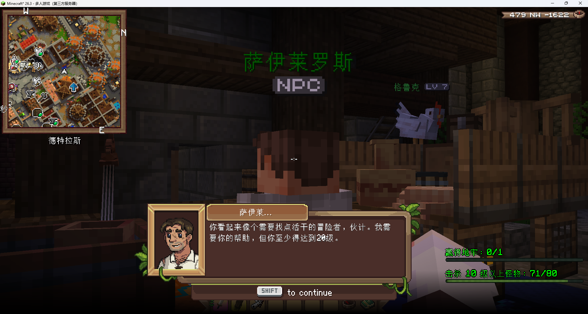
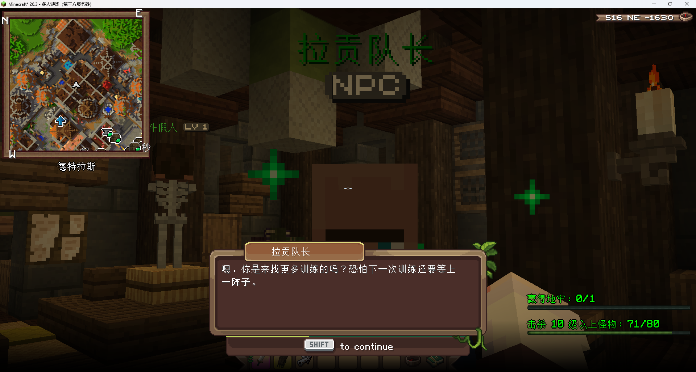

# Lingua Franca · 实时翻译模组


**Minecraft 26.3 · Fabric · 纯客户端翻译模组**

> **公开测试版 Beta 0.0.1** — 功能可用，仍在打磨细节，欢迎反馈问题。

Lingua Franca 把服务器里的英文**实时翻译成中文**：聊天、物品与 Lore、悬停提示、浮空字、木牌、成就、计分板、Tab 列表、Boss 条，以及 Wynncraft 的 NPC 对话框。

不修改资源包、不改服务器数据，只在本机把"显示出来的文字"换成中文。

---

## 功能

| 模块 | 说明 |
|---|---|
| 💬 聊天 | 服务器聊天逐条翻译，保护玩家名不被误翻 |
| 🪧 物品 / Lore | 背包、容器、悬停提示中的名称与描述 |
| 🏷️ 浮空字 / 木牌 | 世界中的全息文字与木牌文本 |
| 🏆 成就 | 进度页的成就名与描述 |
| 📊 HUD | Tab 列表、计分板、Boss 条、动作栏 |
| 🗣️ NPC 对话 | Wynncraft 对话框（名字 / 正文 / 选项） |
| 🧠 本地缓存 | 翻过的文本立即命中，不重复消耗额度 |
| 📚 分服词库 | 每个服务器独立词表与缓存，互不污染 |
| ⚡ 分车道调度 | 按来源拆分队列，某一类爆发不拖慢其它翻译 |
| 🔌 插件联动 | 提供 `translateUi` 接口，兼容解析英文的第三方界面 |

## 截图





## 安装

1. 安装 **Fabric Loader**（Minecraft **26.3**，Java **25+**）与 **Fabric API**；
2. 下载发布页里的 `lingua-franca-0.0.1.jar`，放进 `.minecraft/mods/`；
3. 启动游戏，按 **J** 打开设置，填入翻译服务 **API Key**；
4. 进服务器即可生效。

> 模组本身不附带 API Key。默认使用 DeepSeek（`https://api.deepseek.com`，模型 `deepseek-chat`），也可以换成任何兼容 OpenAI Chat Completions 格式的服务。
>
> 提示：deepseek-flash 属于思考模型，短文本翻译会消耗大量推理 token，可能变慢甚至返回空；翻译场景推荐 deepseek-chat。

## 配置

配置文件：`config/lingua-franca.json`（游戏内按 J 也可修改）

| 字段 | 默认 | 作用 |
|---|---|---|
| `enabled` | true | 总开关 |
| `apiKey` | 空 | 翻译服务 Key（必填） |
| `baseUrl` / `model` | DeepSeek / `deepseek-chat` | 服务地址与模型 |
| `translateChat` | true | 聊天翻译 |
| `translateTooltip` | true | 悬停提示翻译 |
| `translateItemName` / `translateItemLore` | true | 物品名 / 描述翻译 |
| `translateTextDisplay` | true | 浮空字翻译 |
| `translateAdvancements` | true | 成就翻译 |
| `translateSigns` | true | 木牌翻译 |
| `translateTabList` / `translateBossBar` | true | Tab / Boss 条翻译（仅匹配 `tabBossServers` 的服务器） |
| `tabBossServers` | `wynncraft` | Tab/Boss 条生效的服务器关键字 |
| `protectedNames` | 空 | 不翻译的名字列表 |
| `useDefaultFontForChinese` | true | 中文使用默认字体，避免缺字 |
| `maxCache` | 200000 | 每个服务器的本地缓存上限 |
| `debugMetrics` | false | 每 30 秒打印各翻译车道排队情况 |

## 性能设计

- 翻译请求按来源分成 **6 条车道**（主 / 内容预取 / 批量 / 悬停提示 / HUD / 世界），互不抢占；
- 双层结果缓存（组件对象级 + 文本键级），同一文本不重复请求；
- 进服时缓存**异步加载**，不阻塞渲染线程；
- 在途请求上限 400、预取批量上限 300，避免极端情况堆爆内存；
- 缓存定期后台落盘，切换服务器 / 退出时也会保存。

## 常见问题

**需要服务器安装吗？** 不需要，纯客户端模组。

**需要什么前置？** Fabric Loader + Fabric API，Minecraft 26.3，Java 25+。

**可以用别的翻译服务吗？** 可以，修改 `baseUrl` / `model` / `apiKey` 即可（兼容 OpenAI 格式）。

**会改资源包或服务器数据吗？** 不会。

**为什么有些界面还是英文？** 部分服务器或第三方模组使用特殊字体/自绘文本；Wynntils 等需要解析英文的界面会自动跳过翻译，避免破坏其功能。

**第一次遇到的新文本为什么要等一下？** 未命中缓存/词表时需要一次网络翻译，之后会存入本地缓存。

## 从源码构建

需要 JDK 25+ 和已安装的 Minecraft 26.3：

```powershell
# 标准安装位置可自动探测
powershell -ExecutionPolicy Bypass -File .\build-mod.ps1

# 自定义 .minecraft 位置 / JDK
powershell -ExecutionPolicy Bypass -File .\build-mod.ps1 -McDir "D:\.minecraft" -JdkBin "C:\Program Files\Java\jdk-25\bin"
```

输出：`dist/lingua-franca-0.0.1.jar`。

## 目录结构

```
lingua-franca/src/        模组源码（Mixin + 翻译引擎 + 词库）
lingua-franca/resources/  元数据、图标、Mixin 配置
data/                     内置词表与分服数据（构建时打包）
tools/                    词表抓取/导出等辅助脚本
docs/                     教程、更新日志、截图、图标
dist/                     构建产物
```

## 致谢

- 对话框渲染参考了社区 **Translate All in One** 的公开实现思路（字体回退 / 内联重建）；
- 词表数据来自游戏内文本与社区整理。

## 许可证

[MIT](LICENSE)。

---

# English

**Lingua Franca** is a **client-side Fabric mod for Minecraft 26.3** that translates English server text into Chinese in real time: chat, item names and lore, tooltips, holograms, signs, advancements, scoreboard, tab list, boss bars, and Wynncraft NPC dialogue.

- Does **not** modify resource packs or server data — it only replaces displayed text on your client.
- Local cache per server: each phrase is translated once and reused, saving API tokens.
- Modular request lanes keep one busy UI from blocking other translations.

## Install

1. Install **Fabric Loader** for Minecraft **26.3** (Java 25+) and **Fabric API**;
2. Put `lingua-franca-0.0.1.jar` into `.minecraft/mods/`;
3. Launch the game, press **J**, and enter your **API key**;
4. Join a server — translations start immediately.

> You need your own API key. The default backend is DeepSeek (`https://api.deepseek.com`, model `deepseek-chat`); any OpenAI-compatible endpoint works.

## Configuration

Edit `config/lingua-franca.json` or use the in-game screen (J). Main options: `apiKey`, `baseUrl`, `model`, per-module toggles (`translateChat`, `translateItemLore`, ...), `tabBossServers`, `maxCache`.

## Build from source

```powershell
powershell -ExecutionPolicy Bypass -File .\build-mod.ps1 -McDir "C:\.minecraft" -JdkBin "C:\Program Files\Java\jdk-25\bin"
```

## License

MIT — see [LICENSE](LICENSE). This is a **beta (0.0.1)** release; feedback and bug reports are welcome.
